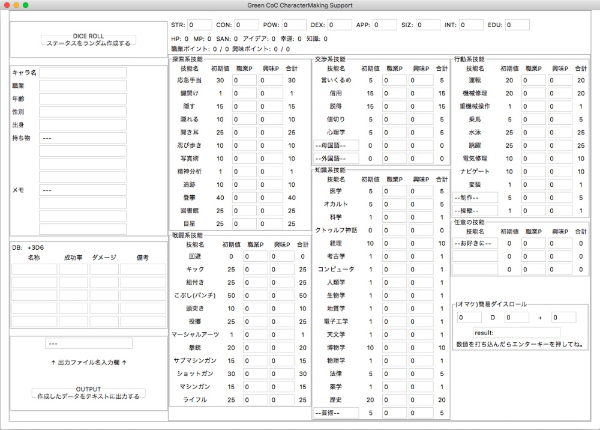

CocCharamakeSupport
===

CoC TRPG のキャラメイク用ツール。 Python 3 の tkinter で作った GUI アプリだよ。

能力値をダイスで決めて、技能ポイントを振り分けて、キャラシートをテキストに出せる。
合計の計算はアプリにおまかせ。

- Docker: 対応!
- Python: 3.15!
- Linter: Ruff 0.17!
- Test: pytest 9.1!
- GUI: tkinter (Tk 8.6)!

## パッと実行してみたい

```bash
docker compose up --build
```

- ログに出る `http://127.0.0.1:6080/vnc.html#autoconnect=true&resize=scale&password=...` をブラウザで開くと、そのまま遊べる
    - コンテナの中の仮想ディスプレイ (TigerVNC) にアプリを出して、 noVNC でブラウザに映している
    - ポートは `127.0.0.1` にだけ公開している。 VNC のパスワードは起動ごとにランダムに作る
    - URL にはパスワードが入るので、ログや URL はほかの人に渡さないでね
- 日本語は直接は打てない (noVNC が IME に対応していないため)
    - noVNC の左端のメニュー → クリップボードに日本語を貼ってから、アプリの入力欄で `Ctrl+V` すると入る
- 職業ポイント・興味ポイントを上限より多く振ると、使ったポイントの数字が赤くなる (振ること自体はできる)
- OUTPUT ボタンで書き出したテキストは `./output/<出力ファイル名>.txt` に出る
    - 書き出したファイル名はボタンの下に出る
    - 同じ名前で何回か OUTPUT すると、同じファイルに追記されていく
    - 数字の欄に数字以外が入っているときや、ファイル名が空・ `/` や `\` 入りのときは書き出さずに、ボタンの下に理由を出す
    - Linux で uid が 1000 以外なら `APP_UID=$(id -u) APP_GID=$(id -g) docker compose up --build` で起動すると書き込める
- 止めるときは `Ctrl+C` (または `docker compose down`)

## テストと lint

```bash
docker compose run --rm --build dev
docker compose run --rm dev ruff check .
docker compose run --rm dev ruff format --check .
```

- 1行目はテスト。イメージにコードをコピーしているので、コードを変えたら `--build` 付きのコマンドから動かす。仮想ディスプレイ (Xvfb) の上でアプリを実際に起動して、入力 → OUTPUT の結果をゴールデンファイル (`tests/golden/`) と比べている
- GitHub Actions でも `master` への push と pull request ごとに同じチェックを回す。アプリのコンテナが起動して noVNC の画面を返すところまで確認する構成だよ



2015-07-12 時点でできること全部詰め込んだもの。
